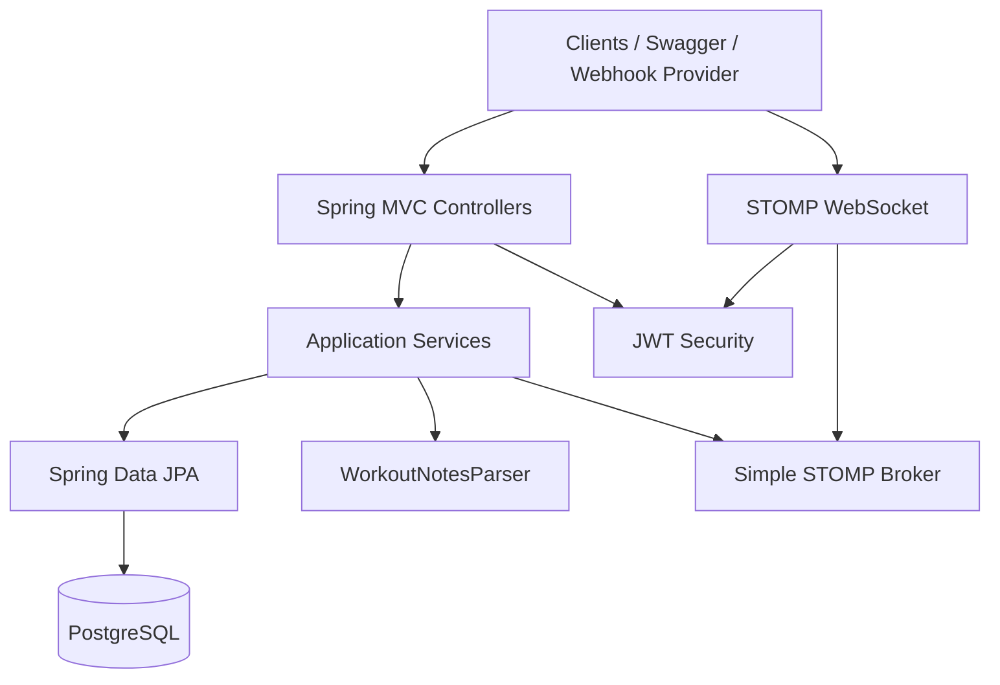

# GymSync

A Spring Boot API plus React SPA for tracking gym workouts: manual logging, training programs,
readiness check-ins, an AI coach (bounded recommendations + chat), signed webhook check-ins from
gym hardware, live WebSocket session updates, AI-assisted import of free-text workout notes (with
mandatory human review), and progressive-overload recommendations.

## Status

**Feature set through Batch 3 is complete and verified** — see
[docs/FULL_AUDIT_2026-07-19.md](docs/FULL_AUDIT_2026-07-19.md) (gap analysis) and
[docs/BATCH3_COMPLETION_REPORT.md](docs/BATCH3_COMPLETION_REPORT.md) (closure evidence). Older
audits ([docs/FINAL_AUDIT.md](docs/FINAL_AUDIT.md), [docs/COMPLETION_AUDIT.md](docs/COMPLETION_AUDIT.md))
document the original Phases 0–9 DoD and are superseded for current product scope.

## Purpose

This is both a working workout-tracking product and a deliberately thorough demonstration of
backend and frontend engineering: layered architecture, JWT auth, transactional integrity under
concurrency, idempotent webhook processing, real-time messaging, and an external-AI integration
that never trusts model output blindly. See `docs/DECISIONS.md` for the reasoning behind specific
choices.

## Key features

- **Auth** — email/password registration and login, stateless JWT (HS256), BCrypt password hashing.
- **Exercise catalog** — a global seeded catalog plus user-owned custom exercises (optional
  thumbnail, demo video URL, and required media attribution when a demo URL is set), filterable by
  name/category, paginated, with per-exercise detail and PR history.
- **Workout tracking** — one active workout per user (DB-enforced), sets scoped per exercise,
  soft-cancel instead of hard delete, optimistic locking against concurrent updates.
- **Training programs** — multi-day programs with ordered exercises; starting a day creates an
  active workout with planned exercises as reference (no fabricated sets).
- **Readiness check-ins** — sleep hours/quality, energy, soreness, stress (1–5), optional note;
  latest check-in surfaces on the Dashboard and feeds coach context.
- **AI coach** — generate / list / accept / modify / dismiss recommendations; chat with an
  injury-keyword safety short-circuit that never calls the LLM. Bounds are enforced server-side.
  See coach endpoints below.
- **Signed webhook check-ins** — HMAC-SHA256 signed requests from a (simulated) gym check-in
  device automatically start a workout, with replay protection and idempotent retries. See
  [docs/WEBHOOKS.md](docs/WEBHOOKS.md).
- **Live WebSocket sessions** — STOMP over `/ws/sessions`, JWT-authenticated, broadcasting
  session/set events to the workout owner only, published only after each transaction commits.
  See [docs/WEBSOCKETS.md](docs/WEBSOCKETS.md).
- **AI-assisted notes import** — paste free-text workout notes and get back a structured,
  pending-review workout; nothing counts toward statistics until a human confirms it. Ships with
  a deterministic rule-based parser by default and an optional OpenAI-compatible LLM parser
  (including Gemini via OpenAI-compatible endpoint). See [docs/AI_NOTES_IMPORT.md](docs/AI_NOTES_IMPORT.md).
- **Stats** — weekly volume/set/rep totals, volume trend and category charts, per-exercise personal
  records (heaviest weight, most reps, estimated 1RM via Epley), and progressive-overload
  recommendations.
- **Frontend SPA** — React + TypeScript (Vite) with sidebar navigation for Dashboard, Workouts,
  Active Session, Exercises, Programs, Readiness, Coach, Notes Import, and Stats.

## Architecture overview

GymSync API is a **modular monolith**: one deployable Spring Boot JAR, one PostgreSQL database,
with module boundaries enforced at the package level rather than over the network.



Full breakdown, module responsibilities, and scaling notes: [docs/ARCHITECTURE.md](docs/ARCHITECTURE.md).

## Technology stack

| Concern | Choice |
|---|---|
| Language / runtime | Java 21 |
| Framework | Spring Boot 3.5 (Web, Security, Data JPA, Validation, WebSocket, Actuator) |
| Database | PostgreSQL 16, Flyway migrations |
| Auth | JWT (`jjwt`), BCrypt |
| Real-time | STOMP over WebSocket |
| API docs | springdoc-openapi / Swagger UI |
| Build | Maven (wrapper included) |
| Testing | JUnit 5, Mockito, MockMvc, Testcontainers (PostgreSQL), JaCoCo |
| Containerization | Multi-stage Docker build, Docker Compose |

## Domain model summary

| Entity | Purpose |
|---|---|
| `User` | Account credentials + role |
| `Exercise` | Global or user-owned catalog entry (`ExerciseCategory`); optional media fields |
| `Workout` | A session: `WorkoutStatus` (`ACTIVE`/`COMPLETED`/`CANCELLED`), `WorkoutSource` (`MANUAL`/`WEBHOOK`/`NOTES_IMPORT`), `ImportStatus` for AI imports |
| `WorkoutSet` | One logged set: exercise, weight, reps, set number, timestamp |
| `Program` / `ProgramDay` / `ProgramDayExercise` | User-owned multi-day plans with ordered exercises |
| `ReadinessCheckIn` | Daily readiness scores (sleep, energy, soreness, stress) + optional note |
| `CoachRecommendation` | Bounded coach advice for an exercise (`PENDING` / `ACCEPTED` / `MODIFIED` / `DISMISSED`) |
| `CheckInEvent` | Audit record of every webhook delivery (`CheckInStatus`), idempotency key |

Full ER details and constraints: [docs/API_DESIGN.md](docs/API_DESIGN.md) and
[docs/DECISIONS.md](docs/DECISIONS.md).

## API endpoint summary

| Method | Path | Notes |
|---|---|---|
| POST | `/api/auth/register` / `/api/auth/login` | Public, returns JWT |
| GET/POST/PUT/DELETE | `/api/exercises`, `/api/exercises/{id}` | Catalog CRUD, ownership-scoped; media fields supported |
| GET | `/api/exercises/{id}/detail` | Exercise detail + recent history |
| GET | `/api/exercises/{id}/pr` / `pr-history` | Personal records |
| GET | `/api/exercises/{id}/next-session-recommendation` | Progressive-overload suggestion |
| POST/GET | `/api/workouts` | Start / list workouts (filterable) |
| GET | `/api/workouts/{id}` | Detail with sets |
| PATCH | `/api/workouts/{id}/complete` | Complete active workout |
| DELETE | `/api/workouts/{id}` | Soft-cancel |
| PATCH | `/api/workouts/{id}/confirm-import` / `/reject-import` | Human review of AI import |
| POST/GET | `/api/workouts/{workoutId}/sets` | Log / list sets |
| PUT/DELETE | `/api/sets/{setId}` | Update / delete a set |
| GET/POST/PUT/DELETE | `/api/programs`, `/api/programs/{id}` | Program CRUD |
| POST/PUT/DELETE | `/api/programs/{id}/days`… | Add / update / delete days |
| POST | `/api/programs/{id}/days/{n}/start` | Start day → active workout + planned exercises |
| POST/GET | `/api/readiness`, `/api/readiness/latest` | Check-in create / latest / date-range list |
| GET/POST/PATCH | `/api/coach/recommendations`… | Generate, list, accept, modify, dismiss |
| POST | `/api/coach/chat` | Coach chat (injury keywords → fixed safety reply, no LLM) |
| POST | `/api/webhooks/checkin` | HMAC-signed, public |
| POST | `/api/notes/import` | AI-assisted notes import |
| GET | `/api/stats/weekly` / `/api/stats/volume-trend` | Weekly stats and volume trend |

Full request/response shapes and error contract: [docs/API_DESIGN.md](docs/API_DESIGN.md). Live,
always-current docs: `http://localhost:8080/swagger-ui.html`.

## Authentication

```bash
curl -s -X POST http://localhost:8080/api/auth/register \
  -H 'Content-Type: application/json' \
  -d '{"email":"you@example.com","password":"SecurePass1!","name":"Your Name"}'
```

The response includes an `accessToken`. Send it on every protected request:

```bash
curl -s http://localhost:8080/api/workouts \
  -H "Authorization: Bearer $ACCESS_TOKEN"
```

## Webhook-signing instructions

Webhooks are authenticated by an HMAC-SHA256 signature over `"<timestamp>." + rawBody`, not a
JWT. Use the included script to generate (and optionally send) a correctly signed request:

```bash
WEBHOOK_SECRET=change-me-webhook-secret ./scripts/sign-checkin-webhook.sh \
  --event-id demo-evt-1 --user-id <uuid> --send
```

Full signing scheme, headers, and idempotency/retry semantics: [docs/WEBHOOKS.md](docs/WEBHOOKS.md).

## WebSocket usage

Connect to `/ws/sessions` with STOMP, presenting the same JWT as a `CONNECT` header
(`Authorization: Bearer <token>`), then subscribe to `/topic/user/{userId}/sessions` and/or
`/topic/session/{workoutId}` to receive live session/set events as you drive the REST API.
Full connection example and event schema: [docs/WEBSOCKETS.md](docs/WEBSOCKETS.md).

## AI notes import & human-review approach

`POST /api/notes/import` turns free text like `"Bench 3x8 135 lb, Squat 5x5 185 lb"` into a
structured `PENDING_REVIEW` workout — it is **never** auto-confirmed. The user must call
`confirm-import` or `reject-import` explicitly, and only a confirmed import counts toward personal
records or weekly statistics. This applies identically whether the text was parsed by the
deterministic default parser or an LLM, because model output (structure, field types, ranges) is
always validated server-side before it can become a `WorkoutSet` — malformed or out-of-range
output is rejected outright rather than coerced. Details, parser selection, and validation rules:
[docs/AI_NOTES_IMPORT.md](docs/AI_NOTES_IMPORT.md).

## Local installation

Prerequisites: Java 21, Maven wrapper (included), Docker (for PostgreSQL and/or Testcontainers),
Node.js (for the frontend).

```bash
git clone <this-repo-url>
cd SetTracker
cp .env.example .env   # then edit secrets as needed

./scripts/start-local.sh
```

That's it — one command brings up the whole stack in the right order:

1. Cleans up anything already running on ports `8080`, `5432`, `5173`/`5174` (stops any
   docker-compose-managed containers with `docker compose down`, kills any other stray process
   left over from a previous session).
2. Starts PostgreSQL (`docker compose up -d postgres`) and waits for `pg_isready`.
3. Starts the Spring Boot API in the background (`./mvnw spring-boot:run
   -Dspring-boot.run.profiles=local`), logging to `logs/api.log`, and polls
   `/actuator/health` until it reports `UP`.
4. Starts the frontend (`npm run dev`, running `npm install` first if `node_modules` is
   missing) in the background, logging to `logs/frontend.log`.
5. Prints a summary with the API URL, Swagger URL, frontend URL, and log file paths.

It's safe to re-run at any time, including while a previous run is still active — it always
cleans up first, so you never get port conflicts or duplicate processes.

When you're done:

```bash
./scripts/stop-local.sh
```

This stops the API, the frontend, and the Postgres container (`docker compose down`) — no
manual `kill`/PID-hunting required.

Verify it's running:

```bash
./scripts/smoke-test.sh
```

Frontend opens at [http://localhost:5173](http://localhost:5173). Vite proxies `/api` and `/ws`
to the backend. CORS defaults include `http://localhost:5173`. Setup details:
[frontend/README.md](frontend/README.md) and [docs/FRONTEND_REQUIREMENTS.md](docs/FRONTEND_REQUIREMENTS.md).

### Running the API directly (without the frontend)

If you only need the database and API, and want to run Maven yourself in the foreground:

```bash
export JAVA_HOME=${JAVA_HOME:-/opt/homebrew/opt/openjdk@21}
export PATH="$JAVA_HOME/bin:$PATH"
docker compose up -d postgres
./mvnw spring-boot:run -Dspring-boot.run.profiles=local
```

## Docker instructions

Run the database only (typical for local development against `mvnw spring-boot:run`):

```bash
docker compose up -d postgres
```

Run the entire stack (API + database) in containers:

```bash
docker compose up --build
```

Or build/run the API image standalone (multi-stage, non-root `gymsync` user, no baked-in
secrets):

```bash
docker build -t gymsync-api .
docker run --rm -p 8080:8080 --env-file .env gymsync-api
```

## Environment variables

See [.env.example](.env.example) for the full, documented list (database, JWT, webhook secret,
CORS, LLM provider, progressive-overload tuning). Never commit a real `.env`; only
`.env.example` placeholders are tracked in git.

## Database migrations

Schema is managed by Flyway (`src/main/resources/db/migration`), applied automatically on
startup. `spring.jpa.hibernate.ddl-auto` is `validate` — Hibernate never generates schema DDL
itself, only checks the entity mapping matches what Flyway has already applied.

## Testing instructions

```bash
export JAVA_HOME=${JAVA_HOME:-/opt/homebrew/opt/openjdk@21}
export PATH="$JAVA_HOME/bin:$PATH"

# Colima users only — point Testcontainers at the Colima Docker socket:
export DOCKER_HOST=unix://$HOME/.colima/default/docker.sock
export TESTCONTAINERS_DOCKER_SOCKET_OVERRIDE=/var/run/docker.sock

./mvnw test           # unit + controller + integration tests (Testcontainers Postgres)
./mvnw clean verify   # Failsafe ITs + JaCoCo + Spotless check + SpotBugs + OpenAPI drift check

# Formatting
./mvnw spotless:check # verify Google Java Format
./mvnw spotless:apply # rewrite sources to match
```

Test layers, tooling, and coverage targets: [docs/TESTING.md](docs/TESTING.md).

## Swagger / OpenAPI

- Swagger UI: `http://localhost:8080/swagger-ui.html`
- Live OpenAPI JSON: `http://localhost:8080/v3/api-docs`
- Live OpenAPI YAML: `http://localhost:8080/v3/api-docs.yaml`
- **Committed static specification:** [docs/openapi.yaml](docs/openapi.yaml)

`OpenApiSpecIT` (Failsafe) fetches `/v3/api-docs.yaml` from the Testcontainers-backed app and
fails if it drifts from the committed file. Regenerate after API changes:

```bash
./mvnw -Dopenapi.update=true -Dit.test=OpenApiSpecIT verify
```

CI uploads `docs/openapi.yaml` as the `openapi-spec` artifact on every workflow run.

An HTTP request collection covering the whole API is also available at
[http/gymsync-api.http](http/gymsync-api.http) (works with any `.http`-file-aware client).

## Example API workflow

```bash
BASE=http://localhost:8080

TOKEN=$(curl -s -X POST $BASE/api/auth/register \
  -H 'Content-Type: application/json' \
  -d '{"email":"demo@example.com","password":"SecurePass1!","name":"Demo User"}' \
  | python3 -c "import sys,json;print(json.load(sys.stdin)['accessToken'])")

WORKOUT_ID=$(curl -s -X POST $BASE/api/workouts -H "Authorization: Bearer $TOKEN" \
  -H 'Content-Type: application/json' -d '{}' \
  | python3 -c "import sys,json;print(json.load(sys.stdin)['id'])")

EXERCISE_ID=$(curl -s "$BASE/api/exercises?query=bench&size=1" -H "Authorization: Bearer $TOKEN" \
  | python3 -c "import sys,json;print(json.load(sys.stdin)['content'][0]['id'])")

curl -s -X POST "$BASE/api/workouts/$WORKOUT_ID/sets" -H "Authorization: Bearer $TOKEN" \
  -H 'Content-Type: application/json' \
  -d "{\"exerciseId\":\"$EXERCISE_ID\",\"weight\":135,\"reps\":8,\"setNumber\":1}"

curl -s -X PATCH "$BASE/api/workouts/$WORKOUT_ID/complete" -H "Authorization: Bearer $TOKEN"

curl -s "$BASE/api/stats/weekly" -H "Authorization: Bearer $TOKEN"
```

`scripts/smoke-test.sh` runs an equivalent flow end-to-end against a live server.

## Project structure

```text
src/main/java/com/gymsync/api/
  auth/         JWT security, register/login
  user/         User aggregate
  exercise/     Exercise catalog (+ media)
  workout/      Workouts + sets
  program/      Multi-day training programs
  readiness/    Readiness check-ins
  coach/        Bounded recommendations + chat
  checkin/      Signed webhook check-ins
  websocket/    STOMP session events
  notesimport/  AI-assisted notes import
  stats/        PRs, weekly stats, charts, overload recommendations
  common/       Errors, correlation IDs, shared config

src/main/resources/db/migration/   Flyway migrations
src/test/java/                     Unit, controller, and integration tests
frontend/                          React + TypeScript SPA (Vite)
docs/                               Focused design/decision documents
scripts/                            Signing, local-start, and smoke-test tooling
http/                               .http request collection
```

## Security considerations

BCrypt password hashing, stateless HS256 JWTs, ownership checks that return 404 (not 403) to avoid
existence leaks, constant-time webhook signature comparison with replay-window protection, no
secrets committed to git or baked into Docker images, and Actuator exposure limited to
`health`/`info`/`prometheus`. Full details: [docs/SECURITY.md](docs/SECURITY.md).

## Concurrency considerations

Every documented race condition (duplicate active workouts, duplicate webhook deliveries,
double-completion, concurrent set writes, double confirm/reject on an import) is resolved by a
database-level constraint or optimistic lock, with a service-level pre-check only for a friendly
error message — never by in-process locking alone, since that wouldn't hold across multiple
application instances. Full write-up with per-case detail: [docs/CONCURRENCY.md](docs/CONCURRENCY.md).

## Known limitations

- The in-memory STOMP broker does not fan out across multiple application instances — WebSocket
  delivery guarantees only hold when running a single instance (see [docs/WEBSOCKETS.md](docs/WEBSOCKETS.md)).
- Personal records and weekly stats are computed on read rather than cached; acceptable at
  single-user scale but would need an explicit cache/invalidation design at higher scale (see
  [docs/CONCURRENCY.md](docs/CONCURRENCY.md)).
- Coach recommendations never auto-mutate workouts; accept/modify only records the user’s choice.
- Local LLM usage (notes import + coach) depends on `.env` (`LLM_PROVIDER`, `LLM_API_URL`,
  `LLM_API_KEY`, `LLM_MODEL`). Without credentials the rule-based implementations are used.
  When Gemini (or another OpenAI-compatible provider) is configured, outbound calls are logged to
  `logs/api.log`.

## Roadmap

**Completed:** auth, exercise/workout/set APIs, signed webhook check-ins, WebSocket session
events, AI notes import with mandatory human review, personal records, weekly statistics,
progressive-overload recommendations, readiness check-ins, AI coach (generate/chat/accept),
training programs, exercise media fields, React SPA (including Readiness and Coach pages),
frontend CI build job.

**Planned:** external STOMP broker for multi-instance deployments, richer exercise name matching
for notes import, optional cached personal records with explicit invalidation.

**Exploratory (design complete, implementation deferred):** a safe AI training-summary assistant
([docs/AI_PERSONAL_TRAINER.md](docs/AI_PERSONAL_TRAINER.md)) and an equipment-photo-to-workout
generator ([docs/EQUIPMENT_PHOTO_WORKOUTS.md](docs/EQUIPMENT_PHOTO_WORKOUTS.md)).

## Future advancements

See [docs/FUTURE_ROADMAP.md](docs/FUTURE_ROADMAP.md), [docs/AI_PERSONAL_TRAINER.md](docs/AI_PERSONAL_TRAINER.md),
and [docs/EQUIPMENT_PHOTO_WORKOUTS.md](docs/EQUIPMENT_PHOTO_WORKOUTS.md).

## Contribution guidelines

This is currently a solo learning/portfolio project and not yet accepting external contributions,
but issues and discussion are welcome. If that changes, this section will be updated with a
`CONTRIBUTING.md`. Issue templates and a pull request template are already in place under
`.github/`.

## License

MIT — see [LICENSE](LICENSE).

## Author

[Author Name] — [author@example.com]
