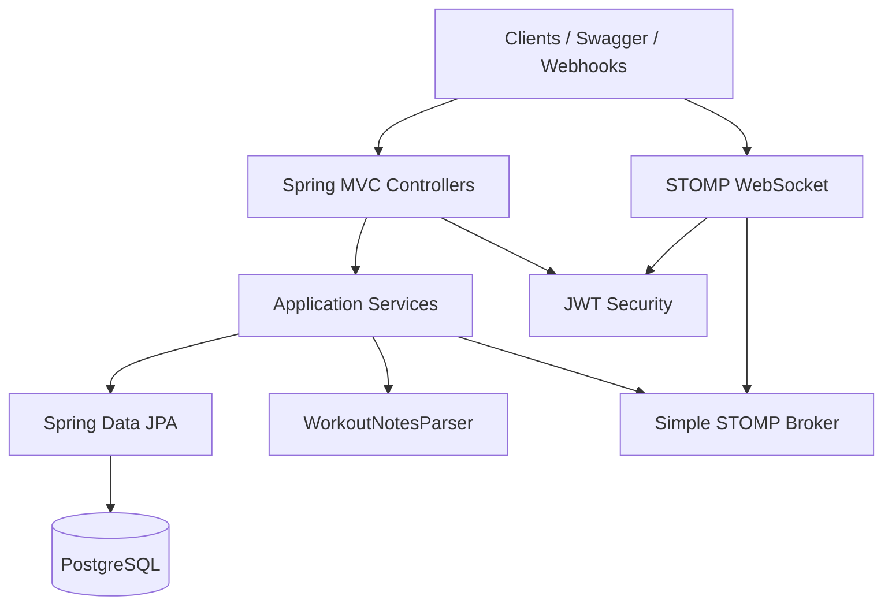

# Architecture

## Overview

GymSync API is a **modular monolith** Spring Boot service. Modules share one PostgreSQL database and one deployable JAR. Boundaries are package-level, not network-level.

## Modules

| Package | Responsibility |
|---------|----------------|
| `auth` | Registration, login, JWT issuance/validation |
| `user` | User aggregate and persistence |
| `exercise` | Exercise catalog (global + user-owned) |
| `workout` | Workouts and sets |
| `checkin` | Signed webhook check-ins |
| `websocket` | Live session event broadcasting |
| `notesimport` | Unstructured notes → structured workouts |
| `stats` | PRs, weekly stats, overload recommendations |
| `common` | Errors, correlation IDs, shared config |

## Cross-cutting concerns

- **Transactions** at the service layer (`@Transactional`)
- **Ownership** enforced in services (404 for inaccessible resources)
- **Events** published only after successful commit
- **External LLM** behind `WorkoutNotesParser` with a deterministic default

## Scalability note

The embedded STOMP simple broker is suitable for local/demo use. Production scale would replace it with an external broker (e.g. RabbitMQ STOMP) without changing domain services that publish through `SessionEventPublisher`.
